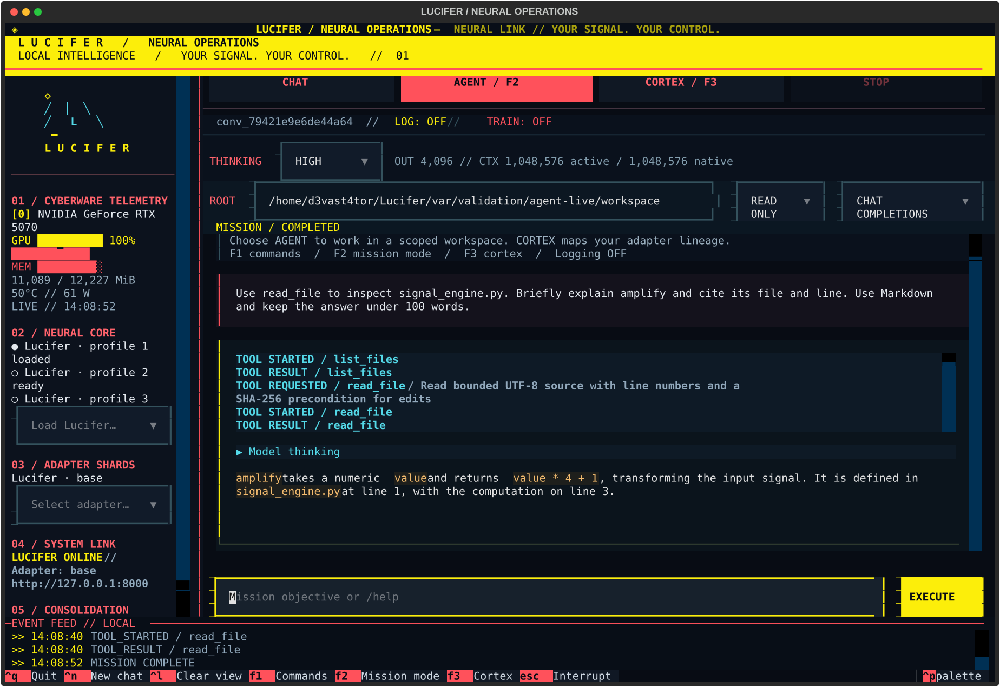

# LUCIFER // neural operations

The canonical installation root is `/home/Lucifer`. See
[attached knowledge and public web research](docs/KNOWLEDGE_AND_WEB.md) for
`/attach`, `/link` and `/knowledge`, and [path migration](docs/PATH_MIGRATION.md)
for moving existing runtime data and model references.

A Cyberpunk 2077-inspired local AI agent with workspace tools, selectable Direct PC
access, an interactive adapter cortex, reviewed feedback and offline LoRA
consolidation. Textual terminal UI + FastAPI + SQLite.
No browser is required.

## Agent missions and Direct PC

**AGENT** is the single conversation workspace for ordinary questions and tasks.
With a tool-capable model loaded, its visible scope governs tool access; models
without that interface provide responses only. `F2` returns to Agent, `F3` opens
the adapter cortex, and **STOP**, `Esc` or `Ctrl+C` pauses the owned
run. Missions have no default wall-clock deadline, round limit, tool-call limit
or cumulative token limit. Each request still has the loaded model's context
limit; when that window is full, Lucifer automatically compacts older history
into a bounded working summary of the project and fundamental repo/docs, then
continues. Tools retain their own bounded inputs, output and process lifetime.
`Ctrl+Q` explicitly quits the terminal UI.

Send a follow-up to continue the same mission. While Lucifer is thinking, use
the **CORRECT** input to change an assumption or direction. Pausing retains the
conversation, tool results, partial answer and emitted thinking in session RAM;
**RESUME** continues that work. **AUTO STOP ON GOAL** defaults to on. Turn it off
to leave the mission awaiting your next input after a final answer, without
generating idle turns. The full [session and expert walkthrough](docs/SESSIONS_AND_EXPERTS.md)
includes command and API examples.

**HISTORY / F5** lists retained sessions, saved checkpoints, public transcripts
and unavailable private runs. Select an entry to inspect its logging/training
status and preview, then **OPEN SESSION** to load it. Opening never resumes work.
An available checkpoint continues only on explicit **RESUME** or a new input,
under its recorded model/profile/adapter and access scope. New conversations save
by default, with training OFF. Use `/privacy logging off` for a private
conversation; `/session save` explicitly enables saving again. Private text
from a session that ended with logging off cannot be recovered from operation
receipts. Provider thinking remains RAM only.

`lucifer tui --session AGENT_RUN_ID` opens an existing mission after connecting.
It reads retained session events or the saved checkpoint; continuing work still
requires explicit input or Resume. If the frontend encounters an unhandled
exception, its crash diagnostic records only exception classes and code-frame
file/function/line locations. It excludes exception messages, local values,
source lines, chat and reasoning.

Press **F4** for the sleep pipeline. **SLEEP / CONSOLIDATE** recovers consented
task context, drafts and verifies examples, reconciles scoped memory, then trains
and evaluates when enough verified data exists. **REVIEW EXAMPLES** lets you
approve, correct or reject pending targets against their displayed content hash.
The view follows the existing telemetry heartbeat; known stage counts
show progress, and unknown totals remain indeterminate. Completion reaches 100%
after the original inference profile is restored. **REVIEW CANDIDATE** opens the
new adapter in Cortex; promotion remains manual.
[Context curriculum and review workflow](docs/CONTEXT_CURRICULUM.md).
For checkpointed rounds, 50-update data refreshes and admission before explicit
activation, see [adaptive Sleep](docs/ADAPTIVE_SLEEP.md).

**Meditation / F6** provides user-started **Supervised** and **Unsupervised**
training of the primary model's existing output head. Both use consented chats
and source-bound documents without a mandatory review step. Automatic evaluation
and verified rollback precede saving an eligible new base revision; activation
is explicit. See [Meditation modes and commands](docs/MEDITATION.md).

```text
/agent workspace /absolute/path/to/project
/agent access read
Find the startup function, explain it and cite its file and line.
/agent access write
Read the configuration and update the requested setting.
/agent access computer
```

READ confines inspection to the workspace. WRITE adds atomic file changes using
the hash from the latest read. SANDBOX (`execute`) adds Linux bubblewrap commands.
**DIRECT PC** (`computer`) permits host commands and absolute file paths outside
the workspace, as requested. This mode runs with the backend user's OS access.
The selected access mode stays visible. Commands show their concrete arguments
for approval; **AUTO CMDS** explicitly authorizes automatic command execution for
the run. Pausing terminates owned command process groups and the model request.

The agent supports Chat Completions, Anthropic Messages and stateless Responses
according to the loaded model's startup snapshot. It validates complete calls,
budgets context and any explicitly configured run limits, and journals effects
before execution. Repeated
completed operations reuse their results; reconnecting the UI never resubmits a
goal. Read-result caches follow current file metadata and invalidate after writes.
Interrupted operations are marked uncertain and are not replayed after restart.

```text
/agent dialect anthropic_messages
/agent dialect responses
/agent image /path/to/local-image.png
/agent image clear
/agent vision on
/agent status
/agent stop
/resume
/correct Use the newer configuration and keep the earlier findings.
/agent auto-stop off
/agent continuation on
/agent open AGENT_RUN_ID
/agent remember An approved summary of the completed result.
```

Images are explicit, bounded local PNG/JPEG/WebP inputs; they require advertised
vision support. In DIRECT PC mode, the agent can also call `capture_screen` to
capture the current desktop; this requires an image-enabled run, a desktop
screenshot utility, and explicit approval. The captured PNG is transient and is
attached to the next model turn. MCP servers are optional and disabled until
configured at startup
using `LUCIFER_MCP_CONFIG`; see `configs/agent-mcp.example.yaml`. Select them with
`/agent mcp SERVER1,SERVER2`. MCP tools share the same registry, argument checking,
approval policy and replay protection. They cannot grant themselves access.

Agent goals, corrections, follow-ups and final answers follow conversation logging
consent. Only completed user/final-answer pairs enter saved chat; tool traces and
reasoning are excluded. Reasoning survives pauses, follow-ups and UI reconnects
while the backend session remains alive. A backend restart discards that RAM
content. `/session new` explicitly selects a new conversation and mission.
Training requires explicit consent and verified eligible material; reviewed
feedback can contribute source targets, while independently verified USER-only
seeds are also supported. Prior file access grants neither training consent nor
documentary evidence for a claim. Remembering a completed
result is an explicit action and requires a saved conversation. Deleting a
conversation also removes its transient agent-export content.

## Adapter cortex

Press **F3** or enter `/brain` to explore a rotating, brain-shaped map of the real
model/adapter registry. Nodes show active, candidate, archived and rejected states;
edges show base/parent lineage. Select a node for rank, evaluation and provenance
details. Arrows or mouse drag rotate/tilt, `Q`/`E` roll, `+`/`-` or the mouse wheel
zoom, Shift+arrows pan, `N`/`P` select, Enter inspects, and `R` resets. Clicking a
node inspects it. Experts use `E` node labels and ordinary adapters use `A` labels.
Activating an eligible
adapter is a separate explicit action.

The cortical surface is an original visualization of registry topology, inspired
by the local Colibri project. It does not claim to display model activations or
measured neural routing. Empty and dense registries, wide and compact layouts are
supported. [Design and data contract](docs/ADAPTER_MAP.md).



## Start on this machine

The primary profile is **Lucifer**, a large quantized model streamed across GPU,
system RAM, and NVMe storage. Its runtime and training environment are installed
locally. The primary weights are downloaded and verified, and the model is loaded.
Its context is selected from the loaded model's metadata; the current native
and allocated limit is **1,048,576 tokens**, and agent history is compacted
automatically when that window is full.

```bash
cd /home/Lucifer/Soul
./scripts/lucifer run --color always
```

The launcher uses `default_model: lucifer` from `configs/models.yaml`. It starts
the backend and terminal together, or attaches to a compatible running backend
for the same project. It stops a backend it started when you exit; an existing
backend stays running. If the requested model is unloaded and its file-based
profile changed, the launcher sends the current resolved profile before loading
it. Already loaded models and explicitly registered runtime profiles keep their
settings. Initial loading of the streamed model can take minutes.
Use `Ctrl+Q` to exit; `Esc` or `Ctrl+C` pauses the owned request.

For a quick UI demonstration without loading weights:

```bash
./scripts/lucifer demo --color always
```

Demo responses are explicitly labeled. Demo and dry-run results cannot establish
an evaluation, create a trained adapter, or qualify for promotion.

## Install elsewhere

Python 3.11+ is required; Linux is the supported backend host.

```bash
python3 -m venv .venv
.venv/bin/pip install -e '.[dev]'
.venv/bin/lucifer init
.venv/bin/lucifer doctor
.venv/bin/lucifer demo
```

Configure models in `configs/models.yaml`. Explicit local model, executable,
training and metadata paths beginning with `./` or `../` resolve from the
configuration file's directory. The first entry in `runtime_command` follows the
same rule; its remaining arguments are passed literally. Hub model IDs and bare
executable names keep their usual meaning. The local Strata launcher repairs
generated runtime metadata after a checkout move, without copying weights.
This checkout still uses a machine-specific cached training checkpoint;
`lucifer init --directory my-config` creates portable examples.
Install vLLM separately for HF inference, or install a suitable `llama-server` build
and set a GGUF path. Existing OpenAI-compatible servers can also be attached.

The local vLLM wrapper uses the sibling `../vLLM/Lucifer` environment. Override
its interpreter with `LUCIFER_VLLM_PYTHON` when installed elsewhere. Training uses
`.train-venv/bin/python` when present, or `LUCIFER_TRAIN_PYTHON` when set.

```bash
lucifer run --models my-config/models.yaml --load lucifer-small
lucifer serve --models configs/models.yaml
lucifer tui --api-url http://127.0.0.1:8000
```

The API binds to loopback by default. Set `LUCIFER_API_TOKEN` to require bearer
authentication; a token is required for a non-loopback bind. Use one backend
process per data directory. The API schema is available at `/docs`.

## Thinking, output budget and context

The thinking selector stays available in wide and compact terminals. Its setting
also has commands:

```text
/thinking off
/thinking low
/thinking medium
/thinking high
/thinking max
/tokens 4096
/tokens auto
/tokens max
```

The selected thinking mode persists across new conversations within the application
and is sent with each request. The normal default is off. The response-only
fallback uses 512 output tokens with thinking off and 4,096 with thinking on.
Agent defaults grow with the
selected thinking level: off 2,048, low 4,096, medium 8,192, high 16,384 and max
32,768. `/tokens N` overrides the budget; `/tokens max` selects the initialized
model's output allowance. This allowance comes from runtime output metadata,
the profile, or remaining active context when no output ceiling is known. Its
source is reported by `output_limit_source`; a profile allowance is not proof of
a native architectural maximum. There is no global 32,768-token output ceiling.

Thinking and the final answer share each request's generation budget. **AUTO
CONTINUE OUTPUT** can continue an agent answer cut off by that budget using the
retained history. Every continuation consumes more of the same finite context;
it does not enlarge the model's native window. Truncated tool calls never execute.
When the provider emits a separate reasoning stream, each response has a **Model thinking**
panel you can expand or collapse, including while generation is running. This is
the model's emitted reasoning, not a guarantee of its internal process. It stays
in terminal and backend session memory and is excluded from saved chats, exports,
durable logs, feedback and training.
With thinking off, that channel is suppressed.

Assistant replies render Markdown headings, lists, tables, links and highlighted
code blocks. User messages remain literal text. Streaming updates are batched to
keep long responses responsive.

`context_length: auto` requests the model's own context instead of imposing a
global 8K or 100K ceiling. vLLM resolves its model configuration; llama.cpp receives
`--ctx-size 0`; the streamed runtime reads its loaded pack's native metadata on
every launch. The API reports `native_context_length` and observed
`effective_context_length` separately. Explicit integer profile limits remain
available as overrides. Unknown native metadata stays unknown rather than being
inferred from a runtime allocation.

The primary model allocated its full native context and answered short test
prompts. This is not a throughput or quality test with a million-token input.

## Dynamic model profiles

Provide a validated JSON or YAML descriptor to register a model without restarting
the app. Registration alone leaves the running model unchanged:

```text
/model register /absolute/path/profile.yaml
/model list
/model load lucifer-custom
/model reload
```

For example, a local GGUF descriptor can contain:

```yaml
id: lucifer-custom
backend: llama.cpp
path: /models/your-model.gguf
served_model_name: Lucifer
context_length: auto
thinking_mode: "off"
n_gpu_layers: -1
```

Select the backend explicitly: a model requiring a custom runtime must use that
runtime. Registration and loading use the descriptor's source and options, with
no checkpoint name built into the application. Runtime registrations persist;
an explicit file reload reapplies matching YAML entries. Changing the currently
loaded descriptor requires unloading first. A reload validates the whole file
before applying changes and refreshes the default without switching the live model.

The same operations are available through `POST /models/register`,
`POST /models/load` (registered `model_id` or inline `spec`), and
`POST /models/reload`. Agent implementation and release evidence are recorded in
[docs/AGENT_PLAN.md](docs/AGENT_PLAN.md).

Supported interfaces are discovered once when each model is initialized, then
served from its capability snapshot at `GET /models/{id}/capabilities`. Explicit
profile changes invalidate that snapshot. Normal chat, telemetry and UI redraws
do not probe the model again. Unknown features remain unknown; advertised support
is distinct from a verified integration.

## Learning workflow

The primary streamed Lucifer profile is for inference. Real LoRA jobs use the
smaller `lucifer-train` profile; its assistant identity is also Lucifer. Expert
jobs can select it with `--base lucifer-train` without manually switching the
chat profile. If exactly one compatible trainable profile exists, it is selected
automatically. Dry-run dataset preparation can be used while the primary profile
is selected.
Original checkpoint sources and licenses are recorded in
[docs/MODEL_PROVENANCE.md](docs/MODEL_PROVENANCE.md).

New conversations save their public user messages and final answers by default.
Training consent defaults to **off** and remains a separate choice. An explicit
`/privacy logging off` remains honored for that conversation; it does not change
the saved-by-default setting for the next new conversation. Provider reasoning
stays in session RAM and is never saved.

```text
/session save
/privacy training on
What is the capital of France?
/feedback good
/sleep start --dry-run
/sleep status
/sleep examples pending
/sleep approve EXAMPLE_ID
/sleep reject EXAMPLE_ID
/sleep start
/adapters
/eval results
/promote CANDIDATE_ID
/rollback
```

`/session save` saves the current session history and enables logging. Feedback
must target a completed saved assistant answer. `/feedback correct ANSWER`
records a complete corrected target, and repeated feedback uses the latest
decision. Consent allows conversation content to become source context; a
positive feedback label alone is not an independent correctness check. The
default curriculum recovers the full task and constraints, verifies proposed
examples, and withholds pending, rejected, duplicate or obsolete material.
Explicit human reviews are recorded as their own validator.
Consented USER-only arithmetic, worked/error-correction tasks and literal scoped
configuration can supply verified seeds without assistant feedback. Unreviewed
assistant answers are never gold targets; freeform drafts stay pending.

Dry runs report preparation and write a private JSONL when an eligible dataset is
produced. Real jobs release managed
inference memory, launch an isolated LoRA/QLoRA worker, restore inference, compare
the candidate with the active baseline on held-out cases, and leave promotion
manual. A failed evaluation leaves the active adapter unchanged. Promotion checks
that both the baseline and evaluation suite still match. Rollback can select a
previously promoted adapter or the base model.

`/sleep start` is the same context-aware pipeline as the F4 start button. It
defaults to at least three useful verified examples, at least two distinct
semantic tasks, and at most 32 generated proposals. The backend also enforces
valid source-group partitions. **REVIEW EXAMPLES**
shows literal questions/answers, provenance and the current full content hash.
Approval can supply a complete multiline correction. A stale hash or superseded
source is rejected; the correction stays in the editor until you explicitly
reload and review the current content. Review produces a new immutable version.

With enough verified data, the job chooses a compatible training base and
topic-related source adapters and freezes its evaluation plan before training.
Implemented exact task probes supplement the regression anchors;
unsupported topics retain unknown quality and cannot satisfy the promotion gate.
The UI reports verified/train/held-out/pending/rejected/duplicate/source-group
counts. `needs_review` or `insufficient_verified_data` ends without pretending an
adapter was trained; review the pending examples and start sleep again. No new
information is a normal no-op. `/sleep start --legacy` or API
`context_examples: false` retains the 0.3 path; `dynamic: false` also disables
automatic expert selection. Full controls are in
[the curriculum workflow](docs/CONTEXT_CURRICULUM.md).

Start adaptive Sleep explicitly and resume the same saved run when needed:

```text
/sleep start --adaptive --thinking max --generation-model lucifer --seed 19
/sleep status
/sleep resume SLEEP_RUN_ID
```

The first passing checkpoint becomes admitted and stops the adaptive loop.
Admission leaves activation explicit on the adapter's compatible Lucifer
profile. The Sleep view reports the adaptive epoch, update budget, growing
random-adjustment bounds, data passes, refresh boundary and measured gates.
See [the adaptive schedule, checkpoints and privacy contract](docs/ADAPTIVE_SLEEP.md).

Training uses **Transformers + PEFT**, the standard LoRA alternative to the
Unsloth example in the specification. The worker masks user/system tokens and
trains only the final assistant answer using the model's own chat template.
GGUF weights are used for inference; set `training_model` to the original HF
checkpoint for training, and export a GGUF LoRA separately for llama.cpp serving.

Reviewed conversations can also create named experts dynamically:

```text
/experts propose
/experts build "Lucifer project procedures" --base lucifer-train --topics python,configuration
/sleep status
/experts list
/experts consolidate "Lucifer combined procedures" ADAPTER_ID_1,ADAPTER_ID_2 --conversations NEW_CONVERSATION_ID
```

`propose` uses reviewed conversation content and excludes examples already
covered by recorded experts. It only proposes topics. `build` starts a real
sleep/training job; a verified checkpoint with optimizer steps and LoRA tensors
establishes a trained expert. Training status and measured evaluation quality
remain separate. Consolidation replays the selected experts' currently consented,
reviewed source conversations, optionally with new conversations, into a fresh
adapter on their shared compatible base. The cortex records every source parent.
These adapters belong to their recorded training base; a 4B expert cannot be
attached to the primary streamed model. See the
[step-by-step expert workflow](docs/SESSIONS_AND_EXPERTS.md#creating-and-updating-experts).

For a separate training environment on another installation:

```bash
python3 -m venv .train-venv
.train-venv/bin/pip install -e '.[train]'
export LUCIFER_TRAIN_PYTHON="$PWD/.train-venv/bin/python"
```

This checkout's `.train-venv` reuses the existing vLLM environment's Torch and
Transformers packages through a `.pth` file; PEFT, Accelerate and bitsandbytes
were installed separately. The original vLLM installation was not modified.
A sibling `.train-venv` is selected automatically when present; the environment
variable overrides it.

## GPUs and workload splitting

`/gpu list` shows connected adapters, runtime availability, IDs, and memory.
The sidebar samples live utilization, VRAM, power and temperature once per second
where supported. GPU utilization and VRAM usage each have a current percentage
bar. Unsupported counters remain
unknown and failed samples are marked stale. Hardware inventory is collected at
startup and shared; polling reads cached counters instead of rediscovering GPUs.
The terminal uses one startup bootstrap and one telemetry request per heartbeat.
Model, adapter and job panels refresh only when their state changes.
Configure GPU selection per model; training also accepts `gpu_devices` and
`multi_gpu` through `/train/start` and `/sleep/start`.

| Workload | Device selection | Splitting |
| --- | --- | --- |
| vLLM | `gpu_devices: all` or physical indices/UUIDs | Automatic tensor parallelism across selected compatible GPUs; configurable pipeline parallelism |
| llama.cpp | `gpu_devices: all` or device names from `llama-server --list-devices` | Layer splitting by default; optional ratios for unequal VRAM |
| LoRA / QLoRA | All visible compatible CUDA/ROCm devices, or an explicit list | Torch distributed data parallel training across selected GPUs |

Defaults use all visible GPUs supported by that engine. Existing CUDA/HIP visibility
masks are respected. A vLLM/training process group requires one runtime; it cannot
combine NVIDIA CUDA and AMD ROCm cards. AMD, Intel, and Apple inference require a
llama.cpp build with the corresponding ROCm, Vulkan, or Metal support. Merely
connecting a GPU does not install its drivers or make every backend support it.

For four compatible vLLM GPUs:

```yaml
gpu_devices: all
# Omit tensor_parallel_size to derive it from the selected count.
pipeline_parallel_size: 1
```

For three GPUs when the model's attention heads cannot be split three ways,
use `tensor_parallel_size: 1` and `pipeline_parallel_size: 3`, provided that
model architecture supports pipeline parallelism. TP × PP must equal the
selected device count. Explicit indices such as `["0", "2"]` choose a subset.

For two llama.cpp devices with unequal memory:

```yaml
gpu_devices: [CUDA0, CUDA1] # Or Vulkan/Metal device identifiers from --list-devices
n_gpu_layers: -1
split_mode: layer
tensor_split: [3, 1]
```

Distributed training divides training examples between GPUs. **Each GPU needs
memory for its own model replica**; DDP does not pool VRAM. Inference tensor/layer
parallelism splits model weights. CPU LoRA is available with `method: lora` and
`gpu_devices: []`; QLoRA needs a supported GPU and bitsandbytes build.

## Commands and data

Press `F1` or type `/help` for commands. Models and promoted adapters also have
selectors. `/history`, `/agent open ID`, `/session export [PATH]`, `/train status`,
`/sleep status`, `/memory QUERY`, and `/gpu list` expose saved work and status.
The layout adapts to small terminals, and large side panels scroll.

By default data lives under `~/.local/share/lucifer` (directory mode 0700,
SQLite/datasets/exports mode 0600). Override with `--data-dir` or
`LUCIFER_DATA_DIR`. Other settings: `LUCIFER_MODELS`, `LUCIFER_EVALS`,
`LUCIFER_API_TOKEN`, `LUCIFER_TRAIN_PYTHON`. External provider keys are referenced
by environment variable names in model profiles, never copied into the registry.
Model and backend logs live in the data directory's `logs` folder.

Turning logging off removes saved messages, feedback, and derived memory for the
conversation while preserving the current session in memory. Turning training
off excludes it from future datasets. Revoking consent also deletes managed
datasets containing the source and blocks promotion of affected candidates.
External exports and already-trained weights are separate artifacts; changing
consent does not erase prior learning.
The scrubber removes common emails, phones, keys, private-key blocks, URLs and
reasoning tags. It is best effort: review the dry-run dataset before real training.

## Scope and verification

The **0.4** release includes terminal chat, model lifecycle, multi-turn agent
sessions, saved conversations, reviewed datasets, real LoRA/QLoRA training,
context-derived curricula, explicit example review, scoped canonical memory,
conversation-derived experts, replay consolidation, sleep jobs, measured
evaluation, promotion and rollback. Generated examples require verification;
raw provider reasoning stays outside the curriculum. Memory search remains
lexical. Vector embeddings, automated scheduling, live shadow testing, multi-user access,
and automatic GGUF conversion are future extensions. The bundled evaluation suite
is a small regression smoke suite, not a comprehensive safety benchmark.

```bash
make check
make build
```

Real hardware validation and remaining hardware limits are recorded in
[docs/VALIDATION.md](docs/VALIDATION.md). GPU configuration follows the official
[vLLM parallelism guide](https://docs.vllm.ai/en/latest/serving/parallelism_scaling/),
[vLLM LoRA guide](https://docs.vllm.ai/en/latest/features/lora/), and
[llama.cpp server documentation](https://github.com/ggml-org/llama.cpp/blob/master/tools/server/README.md).
Training follows [PEFT quantization guidance](https://huggingface.co/docs/peft/developer_guides/quantization)
and the [Transformers Trainer API](https://huggingface.co/docs/transformers/main_classes/trainer).
